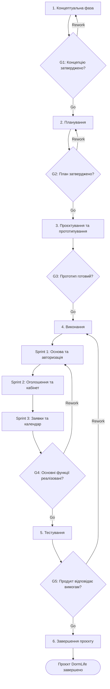

# Життєвий цикл проєкту DormLife

## 1. Обрана модель життєвого циклу

**Назва проєкту:** DormLife — вебзастосунок для мешканців гуртожитку №10 НУБіП України.

**Обрана модель:** гібридна модель (Waterfall + Scrum).

**Тип моделі за сучасною класифікацією:** гібридна (Hybrid).

Для реалізації проєкту DormLife обрано гібридну модель життєвого циклу, яка поєднує послідовне планування за Waterfall та гнучку розробку за Scrum. На початкових етапах команда визначає мету, основні вимоги, функціональність і план реалізації продукту. Безпосередня розробка відбувається короткими ітераціями (спринтами), що дозволяє поступово додавати нові можливості. Такий підхід підходить для командного програмного проєкту, оскільки вимоги можуть уточнюватися під час роботи. Крім того, він дозволяє регулярно перевіряти результати та враховувати відгуки потенційних користувачів.

## 2. Фази життєвого циклу

Для проєкту DormLife визначено шість основних фаз. Загальна орієнтовна тривалість реалізації становить 8 тижнів.

| № | Назва фази | Мета фази | Тривалість (тижнів) | Ключові роботи | Deliverables (проміжні результати) | Відповідальний |
|---|---|---|---|---|---|---|
| 1 | Концептуальна (ініціація) | Визначити проблему, мету та основну ідею проєкту | 1 | Аналіз потреб мешканців гуртожитку, визначення цільової аудиторії, формування цілей і завдань | Project Brief, опис проблеми, мета проєкту, перелік зацікавлених сторін | Team Lead |
| 2 | Планування | Визначити вимоги, функції, ресурси та терміни реалізації | 1 | Формування функціональних вимог, розподіл ролей, складання плану робіт, визначення технологій | Product Backlog, календарний план, розподіл обов'язків, перелік вимог | Team Lead, аналітик |
| 3 | Проєктування та прототипування | Розробити структуру та зовнішній вигляд майбутнього застосунку | 1 | Створення макетів інтерфейсу, проєктування сторінок, визначення структури бази даних і навігації | UI/UX-прототип, схема структури застосунку, архітектурні рішення | UI/UX-дизайнер, розробник |
| 4 | Виконання (розробка за Scrum) | Реалізувати основну функціональність застосунку | 3 | Проведення трьох спринтів, програмування, інтеграція компонентів, перевірка проміжних результатів | Робочі версії застосунку, вихідний код, реалізовані модулі | Scrum Master, команда розробників |
| 5 | Тестування та перевірка | Переконатися у правильній роботі функцій і відповідності вимогам | 1 | Функціональне тестування, перевірка авторизації, оголошень, заявок на ремонт, календаря подій, виправлення помилок | Звіт про тестування, перелік виправлених помилок, перевірена версія продукту | Тестувальник, розробники |
| 6 | Завершення | Підготувати кінцевий продукт і документацію | 1 | Фінальна перевірка, підготовка демонстрації, оформлення документації, підбиття підсумків | Фінальна версія DormLife, README.md, документація, підсумковий звіт | Team Lead, уся команда |

### 2.1. План виконання розробки за спринтами

Фаза виконання поділяється на три спринти тривалістю один тиждень кожен.

| Спринт | Основні завдання | Результат |
|---|---|---|
| Sprint 1 | Створення базової структури вебзастосунку, головної сторінки та авторизації | Працююча основа застосунку та вхід користувача |
| Sprint 2 | Реалізація оголошень, спілкування та особистого кабінету | Основні можливості взаємодії мешканців |
| Sprint 3 | Реалізація заявок на ремонт, календаря подій та інтеграція компонентів | Розширена версія застосунку з основними функціями |

Після кожного спринту команда проводить перевірку виконаних завдань і визначає пріоритети наступної ітерації.

## 3. Ворота між фазами (Phase Gates)

Для контролю виконання проєкту визначено п'ять контрольних точок. На кожній з них команда перевіряє результати поточної фази та приймає рішення щодо подальшої роботи.

| Ворота | Між фазами | Критерії переходу | Можливі рішення |
|---|---|---|---|
| G1 | Концептуальна → Планування | Визначено проблему, мету, цільову аудиторію та основні завдання проєкту. Концепцію погоджено командою | Go / Rework / Kill |
| G2 | Планування → Проєктування | Сформовано перелік функціональних вимог, визначено ролі учасників, терміни та основні ресурси | Go / Rework / Kill |
| G3 | Проєктування → Виконання | Підготовлено макет інтерфейсу, структуру застосунку та план розробки. Основні рішення погоджено | Go / Rework / Kill |
| G4 | Виконання → Тестування | Завершено три спринти, реалізовано заплановані основні функції, компоненти інтегровані в одну систему | Go / Rework / Kill |
| G5 | Тестування → Завершення | Основні функції працюють правильно, критичні помилки виправлені, продукт відповідає визначеним вимогам | Go / Rework / Kill |

**Пояснення рішень:**

- **Go** — результати відповідають критеріям, можна переходити до наступної фази.
- **Rework** — необхідно виправити недоліки та повторно перевірити результати.
- **Kill** — припинення проєкту у випадку неможливості його подальшої реалізації.

## 4. Візуалізація життєвого циклу

Діаграма відображає послідовність основних фаз, контрольні ворота та ітеративну розробку за Scrum.

## 5. Обґрунтування вибору моделі

Для проєкту DormLife було обрано гібридну модель життєвого циклу, оскільки вона дозволяє поєднати чітке планування з можливістю змін під час розробки. Проєкт належить до сфери інформаційних технологій та передбачає створення програмного продукту для конкретної групи користувачів — мешканців гуртожитку. Основні вимоги можна визначити заздалегідь, однак окремі функції та побажання користувачів можуть уточнюватися в процесі роботи.

Під час вибору моделі розглядалися також Waterfall, V-подібна модель та Scrum. Каскадна модель не була обрана як основна, оскільки вона передбачає послідовне виконання етапів і ускладнює внесення змін після завершення попередніх фаз. V-подібна модель більше орієнтована на детальне планування тестування для кожного етапу, що може бути надмірним для невеликого навчального проєкту. Scrum забезпечує гнучкість, але самостійне використання цієї моделі не настільки чітко визначає початкові етапи планування та завершення.

Гібридний підхід має декілька переваг для DormLife. По-перше, команда отримує зрозумілу послідовність робіт і може контролювати виконання кожної фази. По-друге, розробка за спринтами дозволяє поступово реалізовувати функції застосунку та перевіряти їхню роботу. По-третє, використання контрольних воріт допомагає виявляти проблеми до переходу на наступний етап.

Основними ризиками є затримки під час програмування, недостатня узгодженість між учасниками команди, помилки в роботі окремих модулів та зміна вимог. Для їх мінімізації передбачається розподіл завдань між учасниками, регулярне обговорення результатів, використання GitHub для контролю версій і перевірка функціональності після кожного спринту.

Отже, гібридна модель Waterfall + Scrum є доцільним вибором для реалізації DormLife. Вона забезпечує організоване планування, контроль проміжних результатів та можливість адаптувати продукт до потреб майбутніх користувачів. Завдяки цьому команда може поступово створити працездатний вебзастосунок і зменшити ризики під час його реалізації.

## 6. Висновок

Під час виконання лабораторної роботи було спроєктовано життєвий цикл командного проєкту DormLife. Визначено шість основних фаз, їхні цілі, тривалість, ключові роботи, проміжні результати та відповідальних учасників. Для контролю переходів між фазами розроблено п'ять контрольних воріт із критеріями прийняття рішень Go, Rework та Kill.

Також побудовано Mermaid-діаграму, яка відображає послідовність виконання робіт і три спринти розробки. Обґрунтовано використання гібридної моделі Waterfall + Scrum, яка поєднує структуроване планування та гнучкість під час реалізації програмного продукту.

Отримана модель дозволяє команді організувати роботу, контролювати виконання завдань і своєчасно виявляти можливі проблеми під час створення DormLife.
